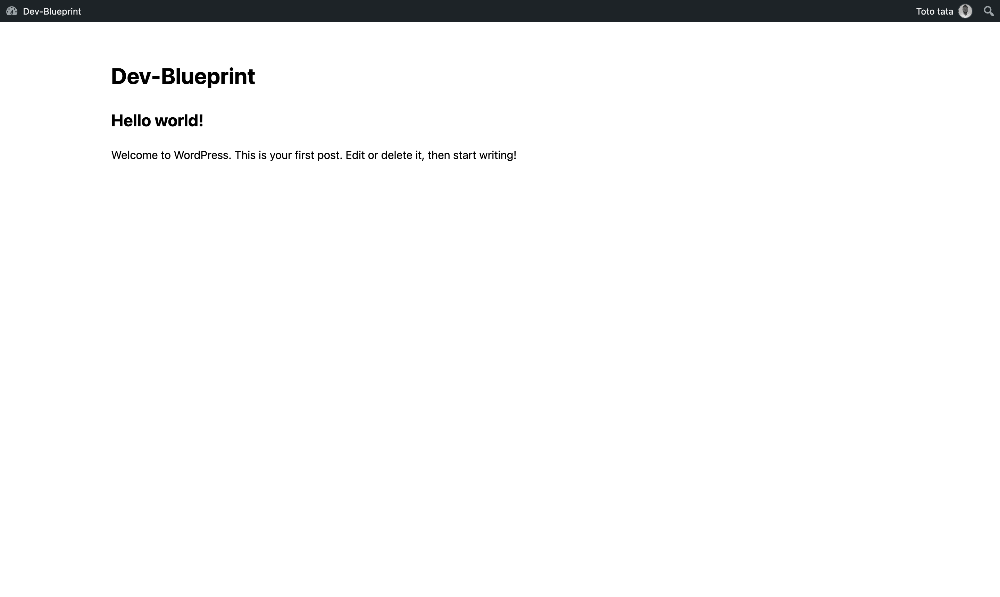

# Dev Base Child Theme

The starter child theme for a client site. Copy it, rename it for
the client, and build that site here — while the
[Dev Base Parent Theme](../wp_devbase_parent_theme) underneath provides
everything shared, and keeps updating itself.



---

## What goes here, and what doesn't

The split is **code that varies per client** against **code that doesn't**
— not "settings" against "functionality".

**Here**

- Design: templates, CSS, JavaScript, images
- This site's forms, post types, taxonomies, extra schema types
- Anything where this client needs to differ from the base theme's defaults

**In the parent**

- Everything shared: SMTP, CAPTCHA, tracking, schema, form logging and
  dispatch, MCP abilities, the update system

**Neither — it's already per-site data**

SMTP credentials, CAPTCHA keys, analytics IDs, organisation details, form
destinations, retention policy, MCP access, licence keys. All entered in
wp-admin and stored in that site's own database. No code anywhere. A
surprising amount of what looks like it needs overriding is just this.

## Starting a new client site

1. **Copy both themes** into the new site's `wp-content/themes/`.
2. **Rename this one** — `acme_theme`, say — and update `Theme Name` in
   `style.css`.
3. **Do not rename the parent.** `Template: wp_devbase_parent_theme` binds
   this theme to that exact directory name, and that stable name is what
   lets one release update every client site.
4. **Activate this theme**, not the parent.
5. **Enter the licence keys** under Theme Settings → Licence.
6. Build.

WordPress refuses to activate a child whose parent is missing, so a wrong
install order gives a clear message rather than a white screen.

## Layout

```
inc/
  overrides/     parent defaults this client changes
    ase.php          admin hardening settings
    admin-menu.php   which wp-admin menu items are hidden
  content/       this client's own structures
    forms.php        the site's forms
    post-types.php   the site's post types and taxonomies
    schema.php       extra schema.org types
views/           Twig templates — resolved child-first, so these win
assets/          CSS and JavaScript, enqueued from functions.php
languages/       this theme's own translations
```

Every file in `inc/` ships as a commented, inert stub. Uncomment what you
need.

## The one rule that will bite you

**WordPress loads this theme's `functions.php` before the parent's.**

That is what makes overriding work — a filter registered here is always in
place before the parent applies it. But it has a hard consequence:

> No parent theme function exists yet while this file is running.

- **Never call a `devbase_*` function at the top level.** Fatal error on
  every page load.
- **Never guard one with `function_exists()`.** It will be false, the code
  will silently do nothing, and you will not enjoy finding out why.
- **Do register filters and actions at the top level.** `add_filter()`
  only stores a callable; nothing is invoked until the parent is loaded.
- **Do use `after_setup_theme` or later** if you genuinely need to *call* a
  parent function rather than hook one.

## Overriding the base theme

```php
// This client runs a blog — give Posts and Comments back.
add_filter( 'devbase/admin_menu/hidden_items', function ( $items ) {
    return array_diff( $items, array( 'edit.php', 'edit-comments.php' ) );
} );
```

| Filter | Purpose |
| --- | --- |
| `devbase/ase/defaults` | Change an admin-hardening default. **Fills gaps only** — a value the site has already saved wins, so this does nothing on an established site. |
| `devbase/ase/enforced` | Change it authoritatively. Reasserted on every admin page load. |
| `devbase/forms/registered_forms` | Register this site's forms. |
| `devbase/admin_menu/hidden_items` | Change which admin menu items are hidden. |
| `devbase/schema/tabs` | Contribute an extra schema.org type. |

**For per-client settings you almost always want `enforced`.** Any site
that has been running has most settings already stored, so `defaults` only
takes effect on a fresh install. The distinction exists because the parent
cannot tell a deliberate change apart from an accidental reset — a child
naming one specific key removes that ambiguity.

The cost of enforcing: that setting can no longer be changed in wp-admin,
because it reverts on the next page load. Use it deliberately.

## Registering this site's content

Post types go in `inc/content/post-types.php`, registered on `init` at the
default priority. Three base-theme features then pick them up with no
further wiring: an archive options page, the archive in the internal link
picker, and an MCP Access entry.

```php
add_action( 'init', function () {
    register_post_type( 'service', array(
        'labels'       => array( 'name' => 'Services', 'singular_name' => 'Service' ),
        'public'       => true,
        'has_archive'  => true,
        'show_in_rest' => true,
        'supports'     => array( 'title', 'editor', 'thumbnail' ),
    ) );
} );
```

Two things to get right:

- **A post type name may be at most 20 characters.** WordPress refuses a
  longer one through a notice rather than an exception, so it simply never
  registers.
- **`show_in_rest => true` is required for MCP editing.** The abilities
  dispatch through the REST API, so a post type without it cannot be edited
  by MCP at all, and will not even appear as something to enable.

Client forms go in `inc/content/forms.php` via the filter — never in the
parent's registry file, which ships identically to every site.

## Templates

Timber resolves templates child-first, so `views/index.twig` here
automatically takes precedence over the parent's placeholder. Delete it and
the parent's comes back.

Four calls are not optional in any layout you build:

```twig
{{ function('wp_head') }}
{{ function('wp_body_open') }}
{{ function('wp_footer') }}
{{ function('body_class') }}
```

Several base-theme features output through exactly these hooks and render
nothing without them — analytics, schema markup, the GTM `<noscript>`
fallback.

For asset URLs, `theme.link` is this theme and `theme.uri` is the parent.

## Styles

`style.css` holds the theme header and no styles. Despite what most child
theme guides imply, WordPress does **not** enqueue it automatically.

Real styles live in `assets/css/main.css`, enqueued from `functions.php`
with `filemtime()` as the version so deploys bust the cache without anyone
bumping a number.

## Versioning and releases

The `Version:` header in `style.css` is the single source of truth — it is
what the update system reports and compares against.

```bash
./bin/bump-version.sh patch    # 1.0.0 -> 1.0.1
./bin/build-zip.sh             # -> acme_theme-1.0.1.zip
```

A release without a version bump reaches nobody, so the script exists to
make that hard to forget. It also refuses to move a version backwards.

This theme has its own release track, separate from the parent's.


## Licence

GPL v2 or later — see [LICENSE](LICENSE). Inherited from the parent theme,
which bundles GPLv2+ code.
